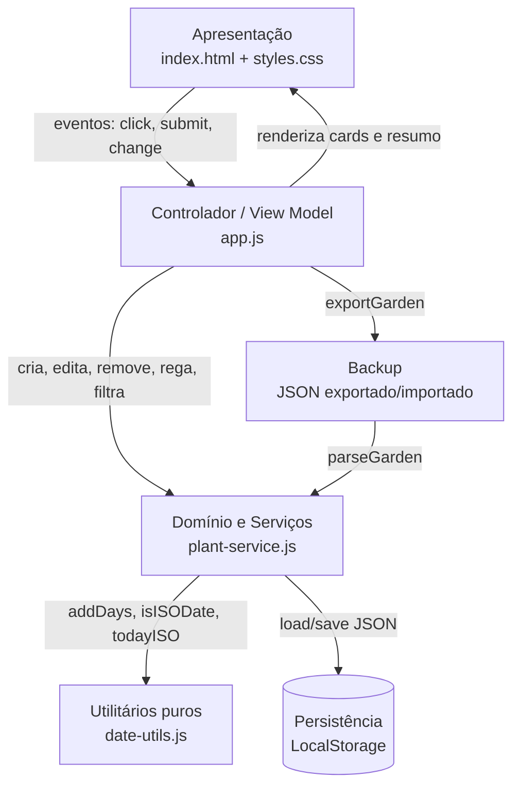
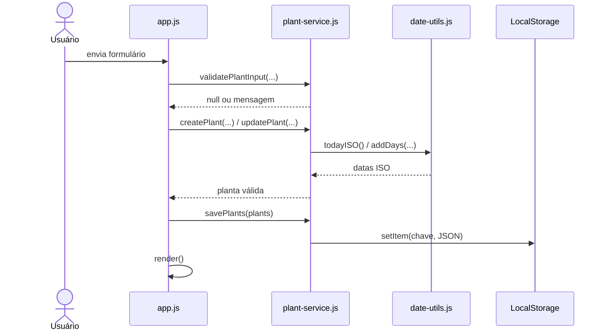

# Documento de Arquitetura de Software — FloraCare

**Versão:** 1.1  
**Última revisão:** 2026-11-07  
**Escopo:** aplicação web estática de gerenciamento de plantas e regas.


---

## 1. Visão Geral e Estilo Arquitetural

O **FloraCare** é uma *Single Page Application* (SPA) executada inteiramente no navegador, sem backend, sem banco de dados externo e sem dependências de runtime. A arquitetura adota uma separação em camadas no lado do cliente (*Client-Side Layered Architecture*), com os princípios de **Separação de Preocupações (SoC)**, **Single Responsibility (SRP)** e **funções puras testáveis**.



### Princípios adotados

1. **Domínio independente da interface:** `plant-service.js` e `date-utils.js` não acessam o DOM.
2. **Funções puras sempre que possível:** cálculo de datas, status, filtros e resumo não alteram os objetos recebidos.
3. **Persistência encapsulada:** somente `plant-service.js` conhece a chave e o formato do `LocalStorage`.
4. **Falha segura:** erros de leitura/gravação/importação não apagam dados existentes; a interface exibe mensagem e mantém o estado anterior.
5. **Sem dependências de runtime:** o build apenas copia os arquivos estáticos; os testes usam o runner nativo do Node.js.

---

## 2. Descrição das Camadas e Módulos

### 2.1 Camada de Apresentação — `src/index.html` e `src/styles.css`

* Estrutura semântica da tela principal, formulário em `<dialog>`, filtros, resumo e *toolbar* de exportação/importação.
* Layout responsivo (3, 2 e 1 coluna), estados de foco visíveis e região `aria-live` para a lista de plantas.
* Não contém regra de negócio; apenas elementos e classes consumidos pelo controlador.

### 2.2 Camada de Controlador — `src/js/app.js`

* Escuta eventos do DOM (adicionar, editar, excluir, regar, filtrar, exportar, importar).
* Mantém o estado em memória (`plants`) e delega toda regra de negócio ao serviço.
* Renderiza cards e resumo a partir de funções puras (`filterPlants`, `summarizeGarden`).
* Trata erros de persistência e de importação com mensagens para o usuário.
* Não implementa cálculo de datas nem validação de domínio.

### 2.3 Camada de Domínio e Serviços — `src/js/plant-service.js`

Responsabilidades:

| Função | Responsabilidade |
| :--- | :--- |
| `validatePlantInput` | Valida nome e intervalo antes de criar/editar. |
| `isValidPlant` | Valida o formato completo de uma planta persistida/importada. |
| `createPlant` | Cria planta com `id` único, data inicial e histórico. |
| `updatePlant` | Atualiza dados cadastrais preservando última rega e histórico. |
| `removePlant` | Remove uma planta sem mutar o array original. |
| `waterPlant` | Registra rega de forma idempotente no mesmo dia. |
| `nextWateringDate` | Calcula a próxima rega. |
| `wateringStatus` | Classifica em `hydrated` ou `thirsty`. |
| `filterPlants` | Filtra por status e ambiente. |
| `summarizeGarden` | Calcula totais do jardim. |
| `loadPlants` / `savePlants` | Abstraem o `LocalStorage` e validam o formato. |
| `exportGarden` | Serializa o jardim em JSON versionado. |
| `parseGarden` | Valida e restaura um JSON exportado. |

### 2.4 Camada de Utilitários — `src/js/date-utils.js`

Funções puras e sem efeitos colaterais:

* `todayISO()` — data local no formato `YYYY-MM-DD`.
* `toISODate(date)` — converte `Date` para ISO local.
* `isISODate(value)` — valida formato e existência real da data (inclui 29/02).
* `addDays(isoDate, days)` — aritmética de dias com virada de mês/ano e anos bissextos.
* `formatDate(isoDate)` — formata para `pt-BR` ou retorna `—`.

### 2.5 Camada de Persistência — `LocalStorage`

* Chave: `floracare.plants.v1`.
* Formato: array JSON de plantas.
* Leitura valida o array inteiro antes de entregar os dados à interface.
* Gravação valida antes de escrever, evitando persistir estado corrompido.
* Limpeza do navegador remove o jardim; por isso existe o backup em JSON (`RF08`).

---

## 3. Modelo de Dados

```json
{
  "id": "uuid-v4",
  "name": "Jiboia da sala",
  "species": "Epipremnum aureum",
  "environment": "Meia-Sombra",
  "intervalDays": 4,
  "lastWateredAt": "2026-11-07",
  "wateringHistory": ["2026-10-30", "2026-11-03", "2026-11-07"]
}
```

Regras de integridade:

* `id`: string não vazia (UUID gerado por `crypto.randomUUID()`).
* `name`: string com pelo menos 2 caracteres após `trim`.
* `species`: string (pode ser vazia).
* `environment`: `Sol Pleno`, `Meia-Sombra` ou `Sombra`.
* `intervalDays`: inteiro maior que zero.
* `lastWateredAt`: data ISO real.
* `wateringHistory`: array de datas ISO reais.

### Formato de exportação (`RF08`)

```json
{
  "schema": "floracare.garden",
  "version": 1,
  "exportedAt": "2026-11-07T12:00:00.000Z",
  "plants": []
}
```

A importação valida `schema`, `version` e todas as plantas antes de substituir o jardim. Em caso de erro, o estado atual permanece intacto.

---

## 4. Fluxos de Dados

### 4.1 Cadastro e edição



### 4.2 Rega e cálculo de status

1. Usuário clica em "Regar agora".
2. `app.js` chama `waterPlant(plant)`.
3. `plant-service.js` atualiza `lastWateredAt`, acrescenta ao histórico (sem duplicar no mesmo dia) e devolve uma nova planta.
4. `savePlants` persiste o novo array.
5. `render` recalcula `nextWateringDate` e `wateringStatus` de cada planta.

### 4.3 Exportação e importação

1. Exportar: `app.js` chama `exportGarden(plants)`, cria um `Blob` e dispara o download.
2. Importar: `app.js` lê o arquivo com `file.text()`, chama `parseGarden(raw)`.
3. Se válido, pede confirmação e chama `savePlants(imported)`; se inválido, exibe erro sem alterar o estado.

---

## 5. Decisões Arquiteturais (ADRs resumidos)

| ID | Decisão | Justificativa | Consequência |
| :--- | :--- | :--- | :--- |
| ADR-01 | `LocalStorage` em vez de backend | MVP local, portátil, sem custo e sem autenticação. | Dados por navegador/perfil; backup manual via JSON. |
| ADR-02 | ES Modules nativos, sem framework | Menor complexidade, carregamento imediato e facilidade de auditoria. | Sem reatividade automática; renderização explícita. |
| ADR-03 | Funções puras no domínio | Testabilidade com `node:test` sem DOM. | Interface precisa orquestrar chamadas e renderização. |
| ADR-04 | JSON versionado para backup | Interoperável, legível e validável. | Necessário manter compatibilidade de schema. |
| ADR-05 | CI com Node.js nativo | Sem dependências de build; pipeline simples e rápido. | Testes não cobrem renderização real no DOM. |

---

## 6. Testabilidade e Integração Contínua

* **Testes unitários:** `test/date-utils.test.js` e `test/plant-service.test.js`, com 46 testes usando `node:test` e `node:assert/strict`.
* **Cobertura de domínio:** validação, criação, edição, exclusão, rega, cálculo de datas, status, filtros, resumo, persistência, exportação/importação e desempenho.
* **Teste de desempenho:** 500 plantas, 10 rodadas de filtro + resumo, limite de 200 ms (`RNF02`).
* **Build:** `npm run build` valida a presença dos arquivos e copia `src/` para `dist/`.
* **Verificação estática:** `npm run lint` valida sintaxe JavaScript e presença dos artefatos obrigatórios.
* **CI:** `.github/workflows/ci.yml` executa `npm ci`, lint, build, testes e cobertura em `push`/`pull_request`; job separado executa `gitleaks` e `npm audit`.
* **Limitação:** a camada de renderização DOM não é testada em navegador real; é verificada por inspeção e pelos testes das funções puras que a alimentam.

---

## 7. Segurança e Privacidade

* Nenhum dado sai do navegador; não há telemetria, backend ou conta de usuário.
* Nenhum segredo é necessário para executar o projeto.
* `gitleaks` e `npm audit` rodam no CI; Dependabot mantém ações e pacotes atualizados.
* A importação de JSON é tratada como entrada não confiável: schema, versão e cada planta são validados antes de qualquer gravação.
* A interface escapa HTML dos dados da planta antes de inserir no DOM (`escapeHTML`), reduzindo risco de XSS armazenado.

---

## 8. Evolução Prevista

| Evolução | Impacto arquitetural |
| :--- | :--- |
| PWA offline | Service worker e cache do app shell. |
| Notificações de rega | API `Notification` ou backend de push. |
| Sincronização multi-dispositivo | Backend/API e autenticação; `plant-service` vira cliente de repositório remoto. |
| Banco local mais robusto | Troca de `LocalStorage` por IndexedDB/SQLite mantendo a interface do serviço. |
| Testes de interface | Playwright/Cypress para fluxos de renderização e acessibilidade. |
