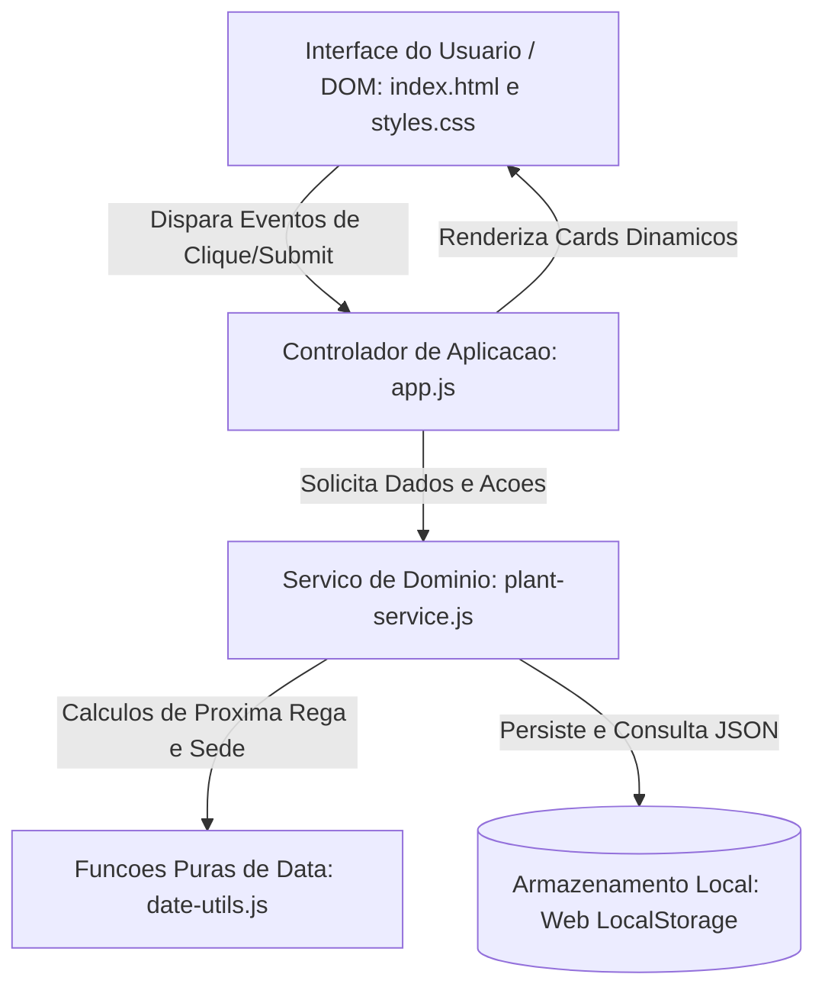

# Documento de Arquitetura de Software — FloraCare

## 1. Visão Geral e Estilo Arquitetural
O **FloraCare** adota uma arquitetura modular em camadas orientada a eventos no lado do cliente (*Client-Side Architecture*), seguindo os princípios de **Separação de Preocupações (SoC)** e **Single Responsibility (SRP)**.

A aplicação é projetada como uma *SPA (Single Page Application)* enxuta, sem dependências de frameworks pesados, garantindo tempo de carregamento imediato (`< 200ms`) e portabilidade universal.

---

## 2. Descrição das Camadas e Módulos

### 2.1. Camada de Apresentação (View / Controller)
- **`src/index.html` e `src/styles.css`:** Responsáveis pela estrutura semântica, responsividade e identidade visual do jardim virtual.
- **`src/js/app.js`:** Atua como Mediador/Controller. Escuta eventos do DOM (adicionar planta, regar, editar, excluir, alternar filtros), aciona a camada de serviço e atualiza o estado visual sem recarregar a página.

### 2.2. Camada de Domínio e Regras de Negócio (Service Layer)
- **`src/js/plant-service.js`:** Encapsula todas as operações de negócio sobre as plantas:
  - Criação, edição, exclusão e validação de atributos obrigatórios.
  - Registro de regas atualizando datas e recalculando o ciclo hídrico.
  - Abstração do armazenamento local (encapsulando a API `localStorage`).

### 2.3. Camada de Utilidades de Domínio (Utils / Pure Functions)
- **`src/js/date-utils.js`:** Módulo puramente funcional, sem efeitos colaterais (*pure functions*), facilitando manutenção e testes:
  - Cálculo da data da próxima rega (`ultimaRega + intervaloDias`).
  - Verificação se a planta precisa de água na data atual ou se está hidratada.

---

## 3. Padrões de Projeto (Design Patterns) Adotados
1. **Module Pattern (ES6 Modules):** Isolamento de escopo por arquivos independentes.
2. **Service Layer Pattern:** As regras de negócio não conhecem elementos de interface (HTML/DOM), permitindo que a camada lógica evolua de forma independente.
3. **Repository / Storage Abstraction:** `plant-service.js` isola o acesso ao `localStorage`, facilitando a troca futura por uma API REST ou banco SQLite.